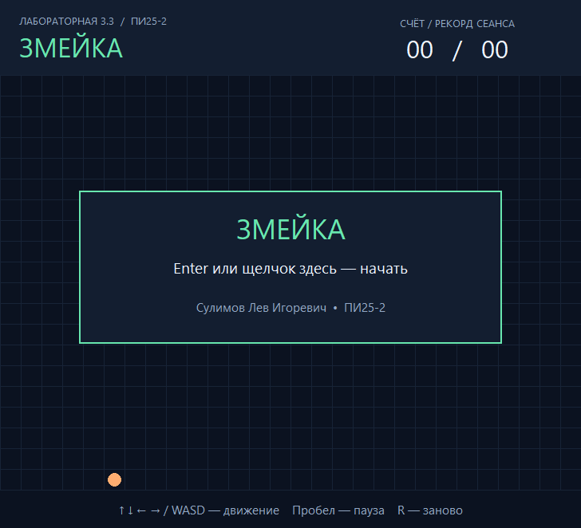
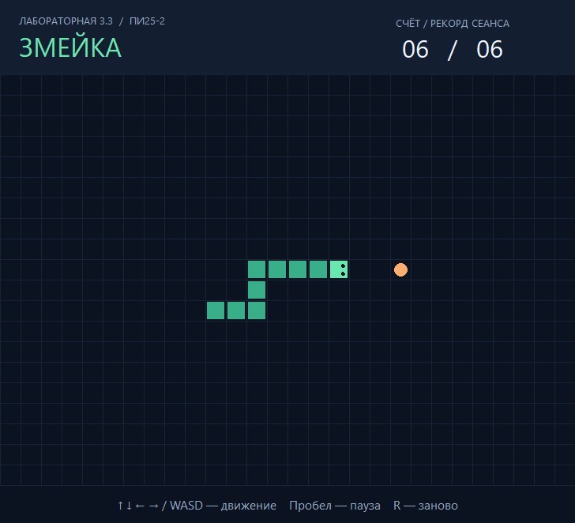

# Лабораторная работа 3.3 — Змейка

**Автор:** Сулимов Лев Игоревич  
**Группа:** ПИ25-2  
**Дисциплина:** Практикум по программированию  
**Дата подготовки:** 24.11.2026  
**Дата сдачи:** 25.11.2026

## Описание проекта

Классическая двумерная игра «Змейка» на Python и tkinter.
Игрок направляет змейку к еде, увеличивает её длину и набирает очки,
избегая столкновений со стенами и собственным телом.

## Проектирование

Модель игры отделена от окна и отрисовки. Все параметры собраны в
`config.py`; графика создаётся средствами Canvas без сторонних ресурсов.

## Функциональные возможности

### Основной функционал

- Клеточное поле 28 × 20, движение по четырём направлениям.
- Случайная еда только в свободной клетке, рост и одно очко за еду.
- Столкновение со стеной или телом завершает партию.
- Запрет разворота на 180° и нескольких поворотов в пределах одного шага.
- Победа при заполнении всего поля.

### Дополнительный функционал

- Постепенное ускорение с 150 до 65 мс между шагами.
- Пауза, повторный запуск, рекорд в пределах открытого окна.
- Автоматическая пауза при переключении на другое окно.
- Отдельные экраны старта, паузы, поражения и победы.

## Демонстрация работы программы

### Главное меню



### Игровое поле



Скриншоты сняты с настоящего окна программы. Для иллюстрации игрового
процесса задано демонстрационное состояние модели.

## Требования к системе

- Python 3.10 или новее; проверено на Python 3.14.7, Windows, Tk 9.0.4.
- Windows, macOS или Linux с графическим рабочим столом и tkinter.
- Только стандартная библиотека: `tkinter`, `random`, `os`, `pathlib`,
  `sys`, `zipfile`; для тестов — `unittest` и `types`.
- Сторонних Python-пакетов нет. `requirements.txt` содержит это пояснение.
- На Linux tkinter может требовать отдельного системного пакета
  `python3-tk`; на Windows выберите Tcl/Tk при установке Python.

## Установка и запуск

### 1. Получение проекта

Откройте терминал и выполните:

```bash
git clone https://github.com/levsulimov/lab-3-3-snake.git
cd lab-3-3-snake
```

При работе с уже подготовленной локальной папкой достаточно открыть в ней
терминал.

### 2. Создание и активация виртуального окружения

По требованию преподавателя настоящее окружение `venv/` включено в Git
и **не исключено через `.gitignore`**. Это подтверждение использования
окружения на компьютере автора. На другом компьютере окружение необходимо
пересоздать: оно содержит пути к конкретной установке Python.

Windows, Git Bash:

```bash
py -3 -m venv venv
source venv/Scripts/activate
```

Windows, PowerShell (активация не обязательна):

```powershell
py -3 -m venv venv
.\venv\Scripts\python.exe -m pip install -r requirements.txt
.\venv\Scripts\python.exe main.py
```

macOS / Linux:

```bash
python3 -m venv --clear venv
source venv/bin/activate
```

Новые версии Python могут создать `venv/.gitignore` с правилом `*`.
Для сохранения окружения по требованиям лабораторной удалите только этот
файл, если он появился. Корневой `.gitignore` исключает кэш Python и файлы IDE.

### 3. Проверка зависимостей

В активированном окружении:

```bash
python -m pip install -r requirements.txt
```

Команда не устанавливает сторонних библиотек: они не нужны.

### 4. Запуск

```bash
python main.py
```

Для уже созданного Windows-окружения также можно открыть `start.cmd`.
В некоторых Windows-сборках Python 3.14 Tcl/Tk хранится в ZIP-архивах.
`prepare_tk()` в `main.py` распаковывает их в `venv/tcl-runtime/` и задаёт
пути только для текущего процесса. Системные настройки не меняются.

### 5. Управление

| Клавиша / действие | Результат |
| --- | --- |
| Enter / щелчок по карточке | Начать партию из меню |
| Стрелки / WASD в английской раскладке | Поворот |
| Пробел | Пауза / продолжение |
| R в английской раскладке | Новая партия |
| Esc | Закрыть окно |

## Структура проекта

```text
lab-3-3-snake/
├── .gitattributes
├── .gitignore
├── README.md
├── requirements.txt
├── main.py
├── config.py
├── models.py
├── view.py
├── start.cmd
├── screenshots/
│   ├── menu.png
│   └── gameplay.png
├── tests/
│   ├── test_model.py
│   └── test_ui.py
└── venv/
```

| Модуль | Назначение |
| --- | --- |
| `main.py` | Подготовка Tcl/Tk и точка входа |
| `config.py` | Размеры, цвета, скорость и другие параметры |
| `models.py` | Класс `SnakeGame`: правила, тело змейки, еда, счёт |
| `view.py` | Класс `App`: окно, Canvas, таймер, события клавиатуры и мыши |
| `tests/` | Проверки модели и обработчиков интерфейса |

Четыре основных модуля отделяют правила от представления и сохраняют
проект небольшим. Модель не импортирует tkinter, поэтому её можно
тестировать без графического рабочего стола.

## Алгоритм и принятые решения

Тело — список пар `(x, y)`, голова находится в начале. Каждый шаг добавляет
новую голову; хвост удаляется, если еда не съедена. Поэтому вход в клетку
уходящего хвоста разрешён. Для новой еды строится список свободных клеток:
это гарантирует завершение алгоритма даже при почти заполненном поле.

При нажатии сохраняется не более одного нового направления до следующего
шага. Это предотвращает разворот в шею двумя быстрыми нажатиями.
Проверка тела занимает O(L), размещение еды — O(W × H), где L — длина змейки.
Анимация выполняется через `after`, без блокирующих циклов и `sleep`.
Рекорд хранится только в памяти до закрытия окна.

## Пример использования

1. Запустите `python main.py` и нажмите Enter.
2. Стрелками направьте голову к оранжевой еде.
3. После еды счёт увеличится на 1, змейка вырастет на одну клетку.
4. Нажмите пробел, чтобы остановить игру, и ещё раз для продолжения.
5. После столкновения нажмите Enter или R для новой партии.

## Проверка работы

Проверка только модели, в том числе без дисплея:

```bash
python -m unittest discover -s tests -p test_model.py -v
```

Полная проверка, включая создание окон tkinter:

```bash
python -m unittest discover -s tests -v
```

Проверено 24.11.2026: **12 тестов пройдено** (9 модели и 3 интерфейса).
Проверяются рост, еда, границы, тело, клетка хвоста, защита от разворота,
пауза, победа, сброс и взаимодействие с меню.

## Контроль версий и соответствие требованиям

Первый коммит содержит только `README.md`, сообщение:
`Сулимов Лев Игоревич`. Далее отдельными коммитами добавлены модель,
интерфейс, проверки и документация. Историю можно посмотреть командой
`git log --oneline --reverse`. Разработка выполнена индивидуально.
Графика создана программно, внешние ресурсы не нужны.
